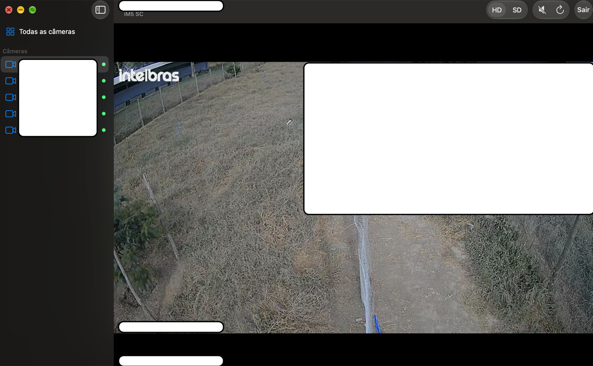

# MiboMac

**[Português](#português) · [English](#english)**

App nativo e **não oficial** para macOS que mostra ao vivo as câmeras **Intelbras Mibo** (as do app *Mibo Smart*) no seu Mac.



---

## Português

> **Aviso:** projeto independente e não oficial, sem afiliação, endosso ou suporte da Intelbras, Imou ou Dahua. "Intelbras" e "Mibo" são marcas de seus respectivos donos. O app usa a mesma API de nuvem do app oficial para Android, obtida por engenharia reversa para fins de interoperabilidade. A Intelbras pode mudar essa API a qualquer momento, e o app pode deixar de funcionar. Use por sua conta e risco (veja a [LICENSE](LICENSE)).

### Recursos
- Login com a sua conta Mibo Smart (e-mail e senha).
- Grade com todas as câmeras online, ou uma câmera por vez em HD/SD.
- Áudio ao vivo: clique na câmera para ouvir e clique de novo para silenciar.
- As transmissões passam pelo relay em nuvem da Intelbras e reconectam sozinhas. Não precisa abrir portas no roteador nem estar na mesma rede das câmeras.
- App universal (Apple Silicon e Intel), macOS 14 Sonoma ou superior.

### Instalação
1. Baixe o `MiboMac.dmg` em [Releases](https://github.com/Saeger/MiboMac/releases) e arraste o **MiboMac** para **Aplicativos**.
2. O app tem assinatura ad-hoc e não é notarizado pela Apple, então o macOS bloqueia a primeira abertura:
   - **macOS 15+:** tente abrir, depois vá em *Ajustes do Sistema → Privacidade e Segurança* e clique em **Abrir Mesmo Assim**.
   - **macOS 14:** clique com o botão direito no app e escolha **Abrir**.
   - Ou, no Terminal: `xattr -dr com.apple.quarantine /Applications/MiboMac.app`

### Primeiro acesso
- Entre com o e-mail e a senha do Mibo Smart.
- Para a sua conta Intelbras, cada Mac é um dispositivo novo. No primeiro acesso, o servidor pede para autorizar o Mac e o app envia um código de verificação para o seu e-mail. Basta digitá-lo uma vez e o Mac fica autorizado.
- Marque **"Lembrar senha"** para guardar a senha no Keychain do macOS e entrar automaticamente.

### Privacidade
- A senha é enviada apenas para a nuvem da Intelbras (`*.easy4ipcloud.com`), por HTTPS. Se você marcar "Lembrar senha", ela fica guardada só no Keychain do seu Mac.
- O e-mail fica salvo nas preferências do app para você não precisar digitá-lo de novo.
- O app guarda um ID aleatório de dispositivo em `~/Library/Application Support/MiboMac/terminal_id`. Ele registra o Mac na sua conta Intelbras com esse ID e com o nome do computador, que é o que aparece na lista de dispositivos da conta. Se você apagar o arquivo, vai precisar verificar o Mac por e-mail de novo.
- Sem analytics e sem servidores de terceiros.

### Compilar a partir do código
Requisitos: macOS 14+ e as Xcode Command Line Tools (`xcode-select --install`).

**Build local rápido** (precisa do FFmpeg do Homebrew):
```sh
brew install ffmpeg
./build.sh
open build/MiboMac.app
```
Esse build só roda em Macs que têm o FFmpeg do Homebrew instalado.

**Build universal independente** (o mesmo usado nas releases):
```sh
./package.sh
```
Na primeira execução, o script baixa o FFmpeg e compila uma versão estática mínima em `vendor/`, o que leva alguns minutos. Depois ele gera `dist/MiboMac.dmg` e `dist/MiboMac.zip`, que rodam em qualquer Mac com macOS 14+ sem Homebrew.

### Diagnóstico
```sh
MIBO_EMAIL=voce@exemplo.com MIBO_PASSWORD='...' build/MiboMac.app/Contents/MacOS/MiboMac --selftest
```
O comando faz login, lista as câmeras e salva um quadro de cada câmera online em `$TMPDIR/mibo_<id>.png`. Use `MIBO_DEBUG=1` para registrar as requisições e respostas da API. Os logs incluem seu e-mail e os IDs das câmeras, então revise antes de compartilhar.

### Problemas comuns
| Mensagem | O que fazer |
|---|---|
| "Este Mac ainda não está autorizado" | Digite o código enviado para o seu e-mail. Use "Reenviar código" se ele expirou. |
| "E-mail ou senha incorretos" | Confira suas credenciais no app oficial Mibo Smart. |
| "Terminal bloqueado por excesso de tentativas" | Muitas tentativas de login com erro. Espere um pouco e tente de novo. |
| Câmera parada em "Conectando…" | Confira se a câmera está online no app Mibo Smart. O app tenta de novo a cada poucos segundos. |

### Contribuindo
Issues e pull requests são bem-vindos. O código é pequeno:
- `Sources/App/MiboAPI.swift`: cliente da API de nuvem (assinatura das requisições, login, lista de dispositivos, URLs de transmissão).
- `Sources/App/MiboMacApp.swift`: interface em SwiftUI.
- `Sources/App/StreamPlayer.swift` + `Sources/CPlayer/`: reprodução RTSP com FFmpeg.

Para desenvolver, você também pode usar `swift build` ou abrir o `Package.swift` no Xcode (precisa do FFmpeg do Homebrew). Para gerar o app, use `build.sh` ou `package.sh`.

Testado apenas com câmeras Mibo na nuvem brasileira da Intelbras (`app-br.easy4ipcloud.com`). Relatos com outros modelos são bem-vindos.

### Licença
O MiboMac é distribuído sob a [Licença MIT](LICENSE).

O app empacotado inclui o [FFmpeg](https://ffmpeg.org) com link estático, licenciado sob a [LGPL v2.1+](https://www.gnu.org/licenses/old-licenses/lgpl-2.1.html). O `package.sh` compila o FFmpeg sem componentes GPL. Você pode recompilar o app com o seu próprio FFmpeg usando os scripts deste repositório, e o código-fonte do FFmpeg está em https://ffmpeg.org/releases/.

---

## English

An unofficial native macOS app for watching **Intelbras Mibo** cameras (the ones you use with the *Mibo Smart* app) live from your Mac.

> **Disclaimer:** This is an independent, unofficial project. It is not affiliated with, endorsed by or supported by Intelbras, Imou or Dahua. "Intelbras" and "Mibo" are trademarks of their respective owners. The app talks to the same cloud API as the official Android app, which was reverse-engineered for interoperability. Intelbras can change that API at any time and break the app. Use it at your own risk (see [LICENSE](LICENSE)).

### Features
- Sign in with your existing Mibo Smart account (email + password).
- See all online cameras in a grid, or open one camera in HD/SD.
- Live audio: click a tile to listen, click again to mute.
- Streams come through the Intelbras cloud relay and reconnect automatically. Your cameras don't need port forwarding or to be on the same network.
- Universal app (Apple Silicon + Intel), macOS 14 Sonoma or later.

The interface is in Brazilian Portuguese.

### Install
1. Download `MiboMac.dmg` from the [Releases](https://github.com/Saeger/MiboMac/releases) page and drag **MiboMac** to **Applications**.
2. The app is ad-hoc signed, not notarized by Apple, so macOS will block it the first time:
   - **macOS 15+:** open it once, then go to *System Settings → Privacy & Security* and click **Open Anyway**.
   - **macOS 14:** right-click the app and choose **Open**.
   - Or, in Terminal: `xattr -dr com.apple.quarantine /Applications/MiboMac.app`

### First sign-in
- Sign in with your Mibo Smart email and password.
- To your Intelbras account, each Mac is a new device. On the first sign-in, the server asks you to authorize the Mac and the app emails you a verification code. Enter it once and the Mac stays trusted.
- Check **"Lembrar senha"** to keep your password in the macOS Keychain so the app signs in automatically.

### Privacy
- Your password is sent only to the Intelbras cloud (`*.easy4ipcloud.com`) over HTTPS. If you choose "Lembrar senha", it is stored only in your macOS Keychain.
- Your email is saved in the app preferences so you don't have to type it again.
- The app keeps a random device ID in `~/Library/Application Support/MiboMac/terminal_id`. It registers your Mac with the Intelbras account using this ID and your Mac's name, which is what shows up in the account's device list. If you delete the file, you'll need to verify the Mac by email again.
- No analytics and no third-party servers.

### Build from source
Requirements: macOS 14+ and the Xcode Command Line Tools (`xcode-select --install`).

**Quick local build** (needs Homebrew FFmpeg):
```sh
brew install ffmpeg
./build.sh
open build/MiboMac.app
```
This build only runs on Macs that have Homebrew's FFmpeg installed.

**Self-contained universal build** (what the releases use):
```sh
./package.sh
```
The first run downloads FFmpeg and compiles a minimal static copy into `vendor/`, which takes a few minutes. The script then writes `dist/MiboMac.dmg` and `dist/MiboMac.zip`, which run on any Mac with macOS 14+ without Homebrew.

### Diagnostics
```sh
MIBO_EMAIL=you@example.com MIBO_PASSWORD='...' build/MiboMac.app/Contents/MacOS/MiboMac --selftest
```
This logs in, lists your cameras and saves one decoded frame per online camera to `$TMPDIR/mibo_<id>.png`. Set `MIBO_DEBUG=1` to log the API requests and responses. The logs include your email and camera IDs, so check them before sharing.

### Troubleshooting
| Message | What to do |
|---|---|
| "Este Mac ainda não está autorizado" | Enter the code sent to your email. Use "Reenviar código" if it expired. |
| "E-mail ou senha incorretos" | Check your credentials in the official Mibo Smart app. |
| "Terminal bloqueado por excesso de tentativas" | Too many failed sign-ins. Wait a while and try again. |
| Camera stuck on "Conectando…" | Check that the camera is online in the Mibo Smart app. The app retries every few seconds. |

### Contributing
Issues and pull requests are welcome. The code is small:
- `Sources/App/MiboAPI.swift`: cloud API client (request signing, login, device list, stream URLs).
- `Sources/App/MiboMacApp.swift`: SwiftUI interface.
- `Sources/App/StreamPlayer.swift` + `Sources/CPlayer/`: RTSP playback with FFmpeg.

For development you can also use `swift build` or open `Package.swift` in Xcode (needs Homebrew FFmpeg). To produce the app bundle, use `build.sh` or `package.sh`.

Only tested with Mibo cameras on Intelbras' Brazilian cloud (`app-br.easy4ipcloud.com`). Reports from other models are appreciated.

### License
MiboMac is released under the [MIT License](LICENSE).

The packaged app statically links [FFmpeg](https://ffmpeg.org), which is licensed under the [LGPL v2.1+](https://www.gnu.org/licenses/old-licenses/lgpl-2.1.html). `package.sh` builds FFmpeg without GPL components. You can rebuild the app against your own FFmpeg with the scripts in this repository, and the FFmpeg source is available at https://ffmpeg.org/releases/.
